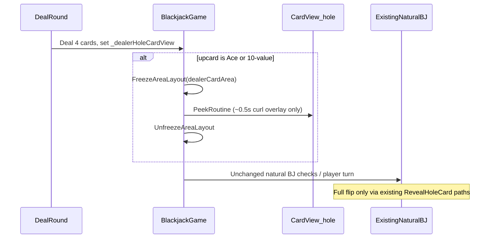

# Dealer Hole-Card Peek Animation

## Current state

- No peek code exists today. [`BlackjackGame.cs`](Assets/Scripts/Blackjack/BlackjackGame.cs) deals four cards, sets `_dealerHoleCardView`, then immediately runs natural-blackjack checks (lines 894–961).
- [`CardView.cs`](Assets/Scripts/Blackjack/CardView.cs) only supports flip + glow. It still has a legacy cleanup list that includes `"CardCurlOverlay"` — the new overlay must **not** use that name in the destroy list, or the reusable peek child will be deleted on every `Setup`/`Flip`.

## Architecture



## Implementation (focused changes only)

### 1. New sprite asset

Create [`Assets/Cards/CardCurlOverlay.png`](Assets/Cards/CardCurlOverlay.png) (+ `.meta`):

- 512×512 RGBA, transparent background
- Soft white highlight + shadow in the **upper-right** corner only
- Import as **Sprite (2D and UI)**, alpha is transparency, **Pivot (1, 1)** top-right

### 2. [`CardView.cs`](Assets/Scripts/Blackjack/CardView.cs)

Add a **Peek Animation** section and `PeekRoutine`:

- `[SerializeField] Sprite peekCurlOverlay` — optional prefab fallback
- `[SerializeField] float peekCornerSize = 0.5f` — overlay size as fraction of card W/H
- `[SerializeField] float peekPeelAngle = 8f` — max corner lift (degrees, negative Z)
- Defaults for move/hold when caller passes non-positive values

**Overlay child** (created once, reused):

- GameObject name: `PeekCurlOverlay` (keep **out of** `LegacyPeekOverlayNames`)
- `Image` anchored top-right, pivot `(1,1)`, size = `cornerSize * cardSize`, sprite = curl overlay
- Render above card face, below or after Glow sibling

**Animation (~0.5s total):**

- Fade alpha `0 → 1`, rotate corner `-peekPeelAngle * amount`, optional tiny scale `0.98 → 1.02`
- Hold ~0.1s
- Reverse to flat, hide overlay
- **Does not** change `cardImage.sprite` or `_isFaceUp`

**Safety:**

- Stop peek coroutine in `Flip()`; hide overlay before flip
- Remove `"CardCurlOverlay"` from legacy destroy list (rename old entries only)
- Extend `Setup(..., Sprite curlOverlay = null)` to store curl sprite from registry

### 3. [`CardSpriteRegistry.cs`](Assets/Scripts/Blackjack/CardSpriteRegistry.cs)

- Add `[SerializeField] Sprite curlOverlaySprite`
- Add `GetCurlOverlaySprite()`

Update [`Assets/Prefabs/CardSpriteRegistry.asset`](Assets/Prefabs/CardSpriteRegistry.asset) to reference the new sprite.

### 4. [`BlackjackGame.cs`](Assets/Scripts/Blackjack/BlackjackGame.cs) — minimal integration

**New Timing fields** (under existing Timing header):

| Field | Default | Purpose |
|---|---|---|
| `dealerPeekMoveDuration` | `0.2` | Curl up / curl down each |
| `dealerPeekHold` | `0.1` | Pause at peak |
| `dealerPeekCornerSize` | `0.5` | Overlay size fraction |
| `dealerPeekPeelAngle` | `8` | Corner lift degrees |

**New helpers** (near existing Hole Card section ~line 2067):

```csharp
private static bool ShouldDealerPeek(CardData upcard) =>
    upcard.Rank == Rank.Ace || upcard.BlackjackValue == 10;

private IEnumerator DealerPeekForNaturalBlackjack()
{
    // guard: hole exists and face-down
    // FreezeAreaLayout(dealerCardArea)
    // SetStatus("Dealer checks for blackjack...")
    // yield PeekRoutine on _dealerHoleCardView
    // clear status, UnfreezeAreaLayout
}
```

**Single insertion point** in `DealRound` after `_dealerHoleCardView` is set and **before** natural-blackjack checks (~line 895):

```csharp
if (ShouldDealerPeek(_dealerHand.Cards[0]))
    yield return StartCoroutine(DealerPeekForNaturalBlackjack());
```

**Pass curl sprite in `SpawnCardView`:**

```csharp
view.Setup(..., faceUp, spriteRegistry.GetCurlOverlaySprite());
```

No changes to `IsNaturalBlackjack`, payouts, `RevealHoleCard`, or player-turn flow.

### 5. Prefab touch-up

[`Assets/Prefabs/CardView.prefab`](Assets/Prefabs/CardView.prefab):

- Optional `peekCurlOverlay` reference (fallback if registry field empty)
- Glow child stays `sizeDelta (0,0)` — no overlap bleed

## Files changed (exact list)

| File | Change |
|---|---|
| `Assets/Cards/CardCurlOverlay.png` | **New** curl sprite |
| `Assets/Cards/CardCurlOverlay.png.meta` | **New** sprite import settings |
| `Assets/Scripts/Blackjack/CardView.cs` | Peek overlay + `PeekRoutine` |
| `Assets/Scripts/Blackjack/CardSpriteRegistry.cs` | `curlOverlaySprite` + getter |
| `Assets/Scripts/Blackjack/BlackjackGame.cs` | Peek trigger + timing fields + `SpawnCardView` pass-through |
| `Assets/Prefabs/CardSpriteRegistry.asset` | Assign curl sprite |
| `Assets/Prefabs/CardView.prefab` | Optional peek sprite + serialized peek defaults |

**Not changed:** scene, glow shader, menu, chip betting, natural-BJ resolution paths (except one yield before them).

## Unity Inspector assignments (required after implementation)

### CardSpriteRegistry (Project window → `Assets/Prefabs/CardSpriteRegistry.asset`)

- **Curl Overlay Sprite** → `Assets/Cards/CardCurlOverlay`

### CardView prefab (`Assets/Prefabs/CardView.prefab`)

- **Peek Curl Overlay** → same sprite (optional fallback; registry is primary)
- Tune under **Peek Animation** if needed: Corner Size `0.5`, Peel Angle `8`

### GameController in scene (object with `BlackjackGame`)

Confirm existing references still set:

- **Sprite Registry** → `CardSpriteRegistry`
- **Card View Prefab** → `CardView`

New **Timing** fields on `BlackjackGame`:

- **Dealer Peek Move Duration** = `0.2`
- **Dealer Peek Hold** = `0.1`
- **Dealer Peek Corner Size** = `0.5`
- **Dealer Peek Peel Angle** = `8`

(Total ≈ `0.2 + 0.1 + 0.2 = 0.5` seconds)

## How to test

1. Deal until dealer upcard is **Ace** or **10/J/Q/K** → curl plays on hole card, card stays face-down, no value shown.
2. Dealer **Dealer BJ** test button → peek, then existing flip + loss presentation if natural.
3. Dealer Ace, hole not 10 → peek only, then **Your turn** with hole still hidden.
4. Dealer 7 upcard → **no peek**.
